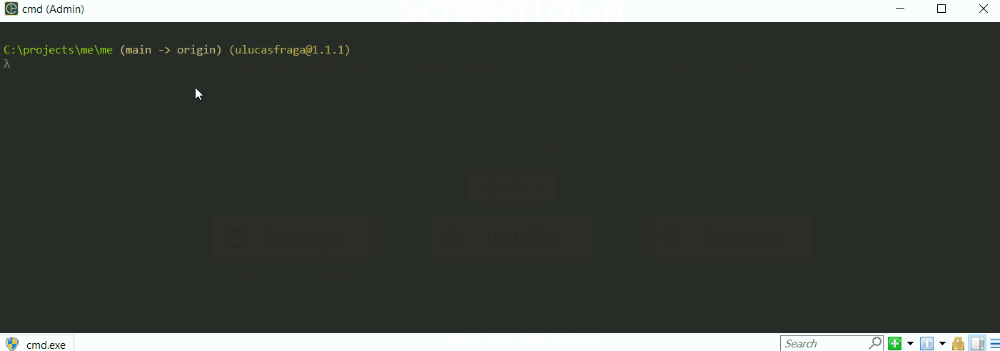
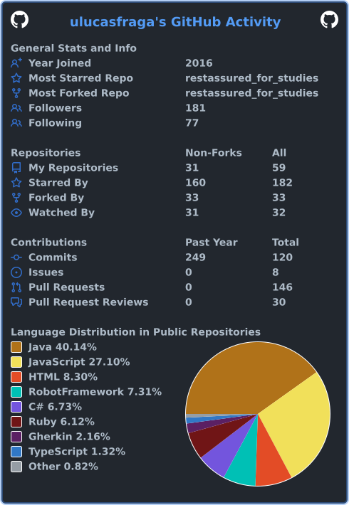

<a href="https://ulucasfraga.github.io/">
  
</a>

QA automation engineer since 2015, based in Lisbon 🇵🇹, born in Rio 🇧🇷. I build the tests that catch bugs before users do, across **web, API, mobile and performance**, and wire them into CI so every deploy has to earn its way to production.

Banking, payments, media, telecom, retail and insurance. Fully remote since 2019, with teams in Brazil, the US and Portugal.

**→ [ulucasfraga.github.io](https://ulucasfraga.github.io/)** · [LinkedIn](https://www.linkedin.com/in/ulucasfraga/) · [Medium](https://medium.com/@ulucasfraga) · [Email](mailto:ulucasfraga@gmail.com)

```text
❯ npx playwright test ulucasfraga.spec.ts

  ✓ [career]  has 11+ years of QA since 2015
  ✓ [web]     automates E2E with Playwright, Cypress and Selenium
  ✓ [api]     validates APIs with RestAssured, Karate and SuperTest
  ✓ [mobile]  tests iOS and Android with Appium
  ✓ [perf]    load-tests with k6, JMeter and Locust
  ✓ [ci]      blocks bad builds with CI quality gates
  ✓ [team]    has led QA teams of up to 8 engineers
  - [life]    stops learning                         (skipped: never)

  7 passed, 1 skipped
```

## Results, written as assertions

```ts
expect(suiteRuntime).toBe('45m');                       // was 4h, large retail platform
expect(regressionCycle).toBe('1 day');                  // was 1 week, 5M+ daily users
expect(dailyTransactions).toBeGreaterThan(1_000_000);   // digital bank: PIX, cards, transfers
expect(peakUsers).toBe(100_000);                        // load-tested before launch
expect(criticalBugsInProd).toBe(0);                     // across 30+ major releases
expect(qaEngineersLed).toBeLessThanOrEqual(8);          // 3 time zones
```

## Toolbox, by test layer

| Layer | Tools |
|---|---|
| Web and E2E | **Playwright**, Cypress, Selenium, Robot Framework, Cucumber, Katalon |
| API and contracts | **RestAssured**, **Playwright API**, Karate, SuperTest, Jest, Joi, **Postman**, Bruno, OpenAPI |
| Mobile | Appium, XCUITest, BrowserStack |
| Performance | k6, JMeter, Locust, Artillery |
| CI/CD and cloud | **GitHub Actions**, **Jenkins**, GitLab CI, Azure DevOps, CircleCI, Docker, Kubernetes, AWS, Terraform |
| Languages and data | **JavaScript**, **TypeScript**, Java, Python, Ruby, C#, PostgreSQL, MySQL, MongoDB, Redis |
| Reporting | **Allure**, Xray, **Jira**, Confluence, SonarQube |
| AI-assisted testing | **Claude Code**, MCP, Kiro |

<sub>Bold: what I use every week right now. Day to day I write JavaScript and TypeScript first, and Java when the stack calls for it. My public repositories are older study kits and do not reflect my current work yet.</sub>

## Starter kits I share

One repository per framework, so anyone can clone a working test setup and start from there.

| Repository | What it shows | |
|---|---|---|
| [restassured_for_studies](https://github.com/uLucasFraga/restassured_for_studies) | REST API tests with RestAssured and JUnit | Java |
| [cypress_api_for_studies](https://github.com/uLucasFraga/cypress_api_for_studies) | REST API tests with Cypress and Mocha | JavaScript |
| [selenium_java_for_studies](https://github.com/uLucasFraga/selenium_java_for_studies) | Web UI tests with Selenium, Cucumber and JUnit | Java |
| [playwright_for_studies](https://github.com/uLucasFraga/playwright_for_studies) | UI and API tests with Playwright | JavaScript |
| [robot_api_for_studies](https://github.com/uLucasFraga/robot_api_for_studies) | REST API tests with Robot Framework | Robot |
| [supertest_for_studies](https://github.com/uLucasFraga/supertest_for_studies) | REST API tests with SuperTest, Mocha, Chai and Joi | JavaScript |
| [uLucasFraga.github.io](https://github.com/uLucasFraga/uLucasFraga.github.io) | My portfolio, with its own Playwright suite running in GitHub Actions | TypeScript |

### My CV, in your terminal

```bash
npx ulucasfraga
```



## Community

- **[Agile Testers](https://agiletesters.github.io/)**, one of the organizers since 2019. Content is on pause, but I still help in the groups every week.
- **Ministry of Testing Rio de Janeiro**, former coordinator: meetups, speakers and a job board for local testers.
- Mentoring QAs moving into automation, and plenty of QA groups where I answer questions.

## Latest writing

<!-- BLOG-POST-LIST:START -->
- [A linha tênue entre o uso da iA e a iQA!](https://medium.com/@ulucasfraga/a-linha-t%C3%AAnue-entre-o-uso-da-ia-e-a-iqa-2a55008f1cde?source=rss-2b50b0ce9651------2)
- [Testando seu “contrato” com o restassured](https://medium.com/assertqualityassurance/testando-seu-contrato-com-o-restassured-f0e974fb9bcb?source=rss-2b50b0ce9651------2)
- [Setting Cypress and Cucumber in e2e tests](https://medium.com/assertqualityassurance/setting-cypress-and-cucumber-in-e2e-tests-6239adac1077?source=rss-2b50b0ce9651------2)
- [Element doesn’t load properly in the browser using Protractor? Let’s solve it!](https://medium.com/assertqualityassurance/element-doesnt-load-properly-in-the-browser-using-protractor-let-s-solve-it-8381b71d3956?source=rss-2b50b0ce9651------2)
<!-- BLOG-POST-LIST:END -->

## Activity



---

<sub>Off the clock: Vasco da Gama fan, surfing whenever the Atlantic cooperates.</sub>
